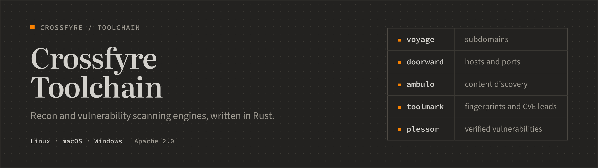
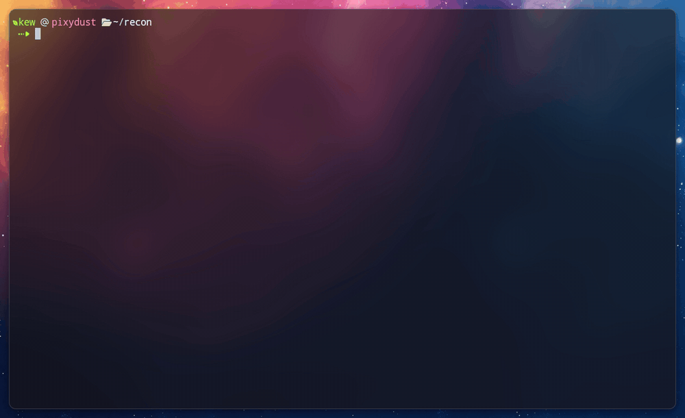

<div align="center">

<a href="https://crossfyre.io"></a>

[](LICENSE)
[](https://www.rust-lang.org)

[](https://discord.gg/cPccst2Vr6)

</div>

Five scanning engines you run from the terminal, on systems you are authorized to test. Each one works on its own, with no account, and nothing leaves your machine unless you connect it to the [Crossfyre platform](https://crossfyre.io) yourself.



| Engine | What it does |
| --- | --- |
| [`voyage`](voyage/) | Finds subdomains, from passive sources and wordlist brute-forcing. |
| [`doorward`](doorward/) | Scans hosts and ports, with service detection. |
| [`ambulo`](ambulo/) | Fuzzes paths and parameters to discover content. |
| [`toolmark`](toolmark/) | Fingerprints services and technologies, and flags CVE leads by version. |
| [`plessor`](plessor/) | Tests for vulnerabilities with nuclei-compatible templates, and confirms each finding before it reports it. |

Alongside them: [`crossfyre`](crossfyre/), the CLI that installs and updates everything, [`node`](node/), the agent that runs the engines for the platform, [`oast`](oast/), an out-of-band server you can host so `plessor` confirms blind bugs on your own domain, and [`mobile`](mobile/), Crossfyre Mobile for Android.

## Install

On Linux (x86_64 or aarch64) or macOS (Intel or Apple silicon):

```sh
curl -fsSL https://get.crossfyre.io/install.sh | sudo bash
```

On Windows, in PowerShell run as administrator:

```powershell
irm https://get.crossfyre.io/install.ps1 | iex
```

<details>
<summary>Or from the apt repository, on Debian, Ubuntu or Kali</summary>

```sh
curl -fsSLO https://bins.crossfyre.io/apt/crossfyre-archive-keyring.gpg
echo "5dd16a4067070a7763afe58deb829c5129618af9ac3bc096637345b6f43cc020  crossfyre-archive-keyring.gpg" | sha256sum -c - && sudo tee /usr/share/keyrings/crossfyre-archive-keyring.gpg < crossfyre-archive-keyring.gpg > /dev/null
sudo tee /etc/apt/sources.list.d/crossfyre.sources > /dev/null <<'EOF'
Types: deb
URIs: https://bins.crossfyre.io/apt
Suites: stable
Components: main
Signed-By: /usr/share/keyrings/crossfyre-archive-keyring.gpg
EOF
sudo apt update
sudo apt install crossfyre crossfyre-archive-keyring
```

The keyring is installed only if its SHA-256 matches. Its key's fingerprint is `992F106C6CF032E43A3CA8BED5D92DAC3BA8CDBF`. After that, `sudo apt upgrade` keeps the CLI current.

</details>

`crossfyre update all` updates the engines. [crossfyre.io/docs/install](https://crossfyre.io/docs/install) covers the .deb, signature checks and removal.

## Use

```sh
# Subdomains of a domain
voyage scan --domain example.com --wordlist-path /usr/share/seclists/Discovery/DNS/subdomains-top1million-5000.txt

# Ports and services across a range
doorward scan --targets 10.0.0.0/24 --ports top-1000 --service-detection

# Content discovery, fuzzing the path at ::FUZZ::
ambulo scan --url https://example.com/::FUZZ:: --wordlist-path /usr/share/seclists/Discovery/Web-Content/common.txt
```

Wordlists are read only from a few directories, since the daemon would otherwise read any file a request names: `/usr/share/wordlists`, `/usr/share/seclists` and the temp directory on Linux, and Homebrew's seclists on macOS. Add your own with `CFX_WORDLIST_ROOTS`, separated like `PATH`.

In a terminal `voyage`, `doorward` and `ambulo` draw a live dashboard. `toolmark` and `plessor` finish a single target in seconds, so they print JSON unless you put `--tui` before `scan`, as in `toolmark --tui scan https://example.com`. Piped or redirected, every engine writes newline-delimited JSON, one event per line, and exits non-zero if the run ends in an error. `voyage`, `doorward` and `ambulo` save findings as they go, so a stopped scan resumes where it left off. Add `--help` to any command for the rest.

## When one machine is not enough

Enrol the host as a node and the same engines run under the [Crossfyre platform](https://crossfyre.io), with a fleet of nodes, scheduled scans, pacing tuned to each target, and one dashboard for your team:

```sh
crossfyre login
crossfyre node init
```

The platform is optional. Nothing here needs it.

## Build from source

With a stable [Rust toolchain](https://rustup.rs):

```sh
git clone https://github.com/clickswave/crossfyre-toolchain.git
cd crossfyre-toolchain
cargo build --release
```

Or install one engine with `cargo install --git https://github.com/clickswave/crossfyre-toolchain.git ambulo`.

A source build sets up no services, so before the first scan start the Postgres container the engines keep their state in (this needs Docker), then the daemon of each engine you use:

```sh
crossfyre db up
ambulo --daemon &
```

`cfx-script` embeds Python, so building it needs one. On Linux that is your distribution's Python and its development files. On macOS it has to be Python 3.10 or later, and the `python3` that comes with the Xcode command line tools is 3.9, so name another one: `PYO3_PYTHON=/opt/homebrew/bin/python3 cargo build --release`. Windows needs no Python to build it, and Python 3.10 or later to run scripts.

A source build, like the binaries on the [Releases](../../releases) page, is the open build. The installer ships the first-party build, which adds the authorization checks, per-node egress isolation, tuned pacing and the browser-fingerprint transport.

<details>
<summary>Running an engine as a daemon on another address</summary>

Every engine can run as a daemon (`--daemon`) that its client talks to over loopback. The protocol is unauthenticated, so the bind address is the security boundary. `CFX_DAEMON_BIND` moves the listener to another IP, and `CFX_DAEMON_TOKEN` makes it require a token, which the clients and the node read from the same variable. If you move the listener, set the token: `ambulo` takes a wordlist path, so an open daemon can be made to read files.

</details>

<details>
<summary>What else is in this repository</summary>

| Crate | What it does |
| --- | --- |
| [`core`](core/) | What `crossfyre` and `node` share: sign-in, installs and updates, the release manifest check, the node service and the Web Tracer. |
| [`capture`](capture/) | The Web Tracer's capture core, used by the desktop proxy and the Android app. |
| [`cfx-script`](cfx-script/) | Runs `.cfx` scripts in an embedded Python interpreter. |
| [`tui`](tui/) | The terminal dashboard every engine draws. |
| [`finding`](finding/) | The one shape every engine reports a finding in. |
| [`transport`](transport/) | The engines' HTTP client. |
| [`dguard`](dguard/) | The daemon listener policy. |
| [`scope`](scope/) | The destinations an operator may test, and the guard that refuses the rest. |
| [`spec`](spec/) | Reads OpenAPI, Swagger, Postman, HAR and Insomnia files. |
| [`surface`](surface/) | Describes a scanned attack surface and diffs it between runs. |
| [`adaptive`](adaptive/) | The engines' pacing and retry decisions, with an untuned baseline. |
| [`relsign`](relsign/) | Signs the release manifest. Used to build releases, not shipped. |

</details>

## Responsible use

Only scan systems you own or have written permission to test. Unauthorized scanning is illegal in most places and can disrupt the systems you point it at.

## Contributing

Issues and pull requests are welcome. Open pull requests against `dev`; `main` tracks the latest release. See [CONTRIBUTING.md](CONTRIBUTING.md). To report a security issue, see [SECURITY.md](SECURITY.md) or email team@clickswave.org rather than opening a public issue.

## License

[Apache License 2.0](LICENSE).

<div align="center">
<sub>Built by <a href="https://clickswave.org">Clickswave</a>. The platform is at <a href="https://crossfyre.io">crossfyre.io</a>.</sub>
</div>
