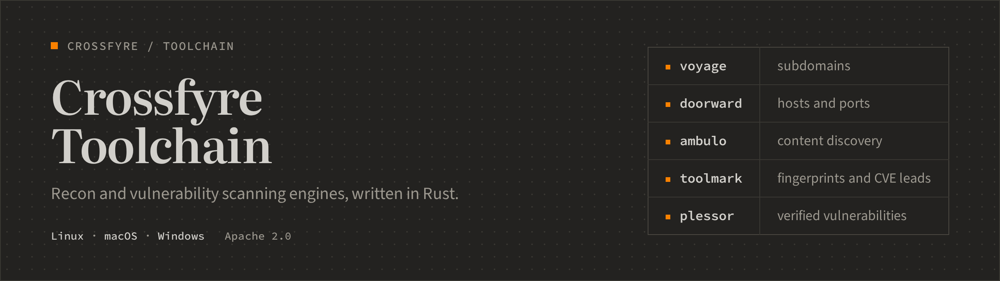
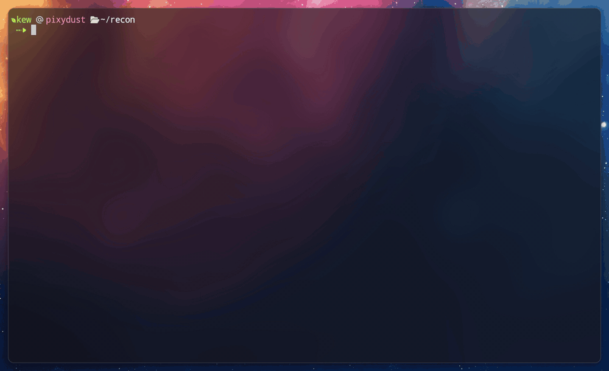

<div align="center">

<a href="https://crossfyre.io"></a>

[](LICENSE)
[](https://www.rust-lang.org)

[](https://discord.gg/cPccst2Vr6)

</div>

Five engines for recon and vulnerability scanning, written in Rust, that you run from the terminal on systems you are authorized to test. Each one works on its own, with no account, and nothing leaves your machine unless you connect it to the [Crossfyre platform](https://crossfyre.io) yourself.



| Engine | What it does |
| --- | --- |
| [`voyage`](voyage/) | Finds subdomains, from passive sources and wordlist brute-forcing. |
| [`doorward`](doorward/) | Scans hosts and ports, with service detection. |
| [`ambulo`](ambulo/) | Fuzzes paths and parameters to discover content. |
| [`toolmark`](toolmark/) | Fingerprints services and technologies, and flags CVE leads by version. |
| [`plessor`](plessor/) | Tests for vulnerabilities with nuclei-compatible templates and an injection engine, and confirms each finding before it reports it. |

Alongside them: [`crossfyre`](crossfyre/), the CLI that installs and updates everything, [`node`](node/), the agent that runs the engines for the platform, [`oast`](oast/), an out-of-band server you can host so `plessor` confirms blind bugs on your own domain, and [`mobile`](mobile/), Crossfyre Mobile for Android, which is [on Google Play](https://play.google.com/store/apps/details?id=io.crossfyre.mobile).

This repository began as [voyage](https://github.com/clickswave/crossfyre-toolchain/tree/voyage), the standalone subdomain finder, and its history is kept on that branch. ambulo began as [mach](https://github.com/clickswave/mach).

## Install

On Linux (x86_64 or aarch64) or macOS (Intel or Apple silicon):

```sh
curl -fsSL https://get.crossfyre.io/install.sh | sudo bash
```

On Windows, in PowerShell run as administrator:

```powershell
irm https://get.crossfyre.io/install.ps1 | iex
```

<details>
<summary>Or from the apt repository, on Debian, Ubuntu or Kali</summary>

```sh
curl -fsSLO https://bins.crossfyre.io/apt/crossfyre-archive-keyring.gpg
echo "5dd16a4067070a7763afe58deb829c5129618af9ac3bc096637345b6f43cc020  crossfyre-archive-keyring.gpg" | sha256sum -c - && sudo tee /usr/share/keyrings/crossfyre-archive-keyring.gpg < crossfyre-archive-keyring.gpg > /dev/null
sudo tee /etc/apt/sources.list.d/crossfyre.sources > /dev/null <<'EOF'
Types: deb
URIs: https://bins.crossfyre.io/apt
Suites: stable
Components: main
Signed-By: /usr/share/keyrings/crossfyre-archive-keyring.gpg
EOF
sudo apt update
sudo apt install crossfyre crossfyre-archive-keyring
```

The keyring is installed only if its SHA-256 matches. Its key's fingerprint is `992F106C6CF032E43A3CA8BED5D92DAC3BA8CDBF`. After that, `sudo apt upgrade` keeps the CLI current.

</details>

<details>
<summary>Or the CLI on its own, from Homebrew or Scoop</summary>

```sh
brew install clickswave/tap/crossfyre
```

```powershell
scoop bucket add clickswave https://github.com/clickswave/scoop-bucket
scoop install clickswave/crossfyre
```

These install the `crossfyre` CLI for your own user, and the package manager keeps it current. The engines and the node service go into a system directory, so for those use the installer above.

</details>

`crossfyre update all` updates the engines. [crossfyre.io/docs/install](https://crossfyre.io/docs/install) covers the .deb, signature checks and removal.

When the CLI fetches from bins.crossfyre.io, the request's User-Agent carries its name, version and platform and whether it is an install, an update or a check of the release manifest, and nothing else.

## Use

```sh
# Subdomains of a domain
voyage scan example.com --wordlist-path /usr/share/seclists/Discovery/DNS/subdomains-top1million-5000.txt

# Ports and services across a range
doorward scan 10.0.0.0/24 --ports top-1000 --service-detection

# Content discovery, fuzzing the path at ::FUZZ::
ambulo scan https://example.com/::FUZZ:: --wordlist-path /usr/share/seclists/Discovery/Web-Content/common.txt
```

A wordlist can be any file you can read: the command line reads it and sends its words to the daemon, a chunk at a time. A request that names a wordlist path instead, as the node's do, is read by the daemon only from a few directories, since it would otherwise read any file a request names: `/usr/share/wordlists` and `/usr/share/seclists` on Linux, Homebrew's seclists on macOS, and in the temp directory only the lists the node hands over. Add your own directories for those with `CFX_WORDLIST_ROOTS`, separated like `PATH`.

In a terminal every engine's `scan` draws a live dashboard, and so do `toolmark services` and `plessor inject`. `--no-tui` prints JSON instead, and `exec` always does. Piped or redirected, every engine writes newline-delimited JSON, one event per line, and exits non-zero if the run ends in an error. `voyage`, `doorward` and `ambulo` save findings as they go, so a stopped scan resumes where it left off. Add `--help` to any command for the rest.

From 0.1.38, `crossfyre completions <shell>` prints a completion script for bash, zsh, fish, powershell or elvish: `mkdir -p ~/.local/share/bash-completion/completions && crossfyre completions bash > ~/.local/share/bash-completion/completions/crossfyre`. Each engine takes the same command, as in `voyage completions zsh`.

From 0.1.38, `crossfyre mcp` serves `toolmark` and `plessor` to an MCP client over stdio, so an agent can fingerprint a service, test endpoints for injection and replay single requests, and refuses any destination that a scope file you write does not list. See [crossfyre/MCP.md](crossfyre/MCP.md).

## When one machine is not enough

Enrol the host as a node and the same engines run under the [Crossfyre platform](https://crossfyre.io), with a fleet of nodes, scheduled scans, pacing tuned to each target, and one dashboard for your team:

```sh
crossfyre login
crossfyre node init
```

The platform is optional. Nothing here needs it.

## How the engines run

Each engine is a daemon and the commands that talk to it. The daemon does the work, on 127.0.0.1 and a port of its own (ambulo 4441, voyage 4442, doorward 4443, toolmark 4444, plessor 4445), and the commands you type are its clients. When a command finds no daemon on its port it starts one: on Linux the engine's systemd user unit, when `crossfyre` registered one for you, and otherwise the engine's own binary, which writes to `logs/<engine>.log` in the toolchain directory (`~/.config/crossfyre` on Linux). The command says `started voyage daemon (pid N)` on stderr, so its JSON on stdout stays clean.

A daemon started from the binary exits once it has had no client and no scan for 30 minutes. For another limit, set `CFX_DAEMON_IDLE_EXIT` to a number of seconds in the environment of the command that starts it. `voyage daemon`, and the same for every engine, runs one by hand, which never exits on its own. `--no-autostart` or `CFX_NO_AUTOSTART=1` turns the starting off. Nothing is started for a command run with sudo, since the daemons and their database belong to your user.

Where no service manager runs, as on WSL without systemd and in most containers, `crossfyre node up` runs the engines along with the node. It runs them as you, starts one again when it exits and stops them when it stops, and `crossfyre extension start` says so instead of starting one. `node up` runs in the foreground there, so start it where it keeps running, such as a container's command or tmux. On WSL, turning systemd on lets the services run the engines instead.

## Where scan state is kept

voyage, doorward and ambulo keep the state of every scan in PostgreSQL, so a stopped scan picks up where it left off. `config.toml` in the toolchain directory names the database they use.

By default it is a local one: a PostgreSQL cluster of your own in the toolchain directory, made with the PostgreSQL programs installed on the machine (on Debian, Ubuntu or Kali, `sudo apt install postgresql`). It runs as you, listens on 127.0.0.1 only, and its generated password is kept in `config.toml`. The first daemon to start makes it, or `crossfyre db up` does ahead of time. `crossfyre db stop` stops it, and `crossfyre db status` says how it is.

To use a PostgreSQL server you run yourself, record it with `crossfyre db external HOST PORT USER`. It asks for the password, or reads it from `CROSSFYRE_DB_PASSWORD`, and records the server only once it lets that user in. The engines keep their tables in one database there, `crossfyre` unless `db_name` in config.toml names another, with a schema each. The local database is stopped and kept with its settings, and `crossfyre db up` goes back to it.

A scan's settings are kept so that it can be taken up again, without the credentials it was given: a scan that needs them is given them again. `crossfyre db status` says how much each engine keeps. `crossfyre db purge --scan ID` deletes one scan with what it found, and `crossfyre db purge --older-than DAYS` every scan made longer ago than that, from every engine; a running scan is left alone. Each engine's own `db purge` does the same for that engine, and its `db reset` deletes everything it keeps.

## Build from source

With a stable [Rust toolchain](https://rustup.rs):

```sh
git clone https://github.com/clickswave/crossfyre-toolchain.git
cd crossfyre-toolchain
cargo build --release
```

Or install one engine with `cargo install --git https://github.com/clickswave/crossfyre-toolchain.git ambulo`.

A source build sets up no services, and needs none: the first command you give an engine starts its daemon, and the first of voyage's, doorward's and ambulo's daemons makes the local database, so install PostgreSQL's programs before the first scan. [How the engines run](#how-the-engines-run) has the rest.

`cfx-script` embeds Python, so building it needs one. On Linux that is your distribution's Python and its development files. On macOS it has to be Python 3.10 or later, and the `python3` that comes with the Xcode command line tools is 3.9, so name another one: `PYO3_PYTHON=/opt/homebrew/bin/python3 cargo build --release`. Windows needs no Python to build it, and Python 3.10 or later to run scripts.

A source build, like the binaries on the [Releases](../../releases) page, is the open build. The installer ships the first-party build, which adds the authorization checks, per-node egress isolation, tuned pacing and the browser-fingerprint transport.

<details>
<summary>Running an engine as a daemon on another address</summary>

Every engine can run as a daemon (`<engine> daemon`) that its client talks to over loopback. The protocol is unauthenticated, so the bind address is the security boundary. `CFX_DAEMON_BIND` moves the listener to another IP, and `CFX_DAEMON_TOKEN` makes it require a token, which the clients and the node read from the same variable. If you move the listener, set the token: `ambulo` takes a wordlist path, so an open daemon can be made to read files.

</details>

<details>
<summary>What else is in this repository</summary>

| Crate | What it does |
| --- | --- |
| [`core`](core/) | What `crossfyre` and `node` share: sign-in, installs and updates, the release manifest check, the node service and the Web Tracer. |
| [`capture`](capture/) | The Web Tracer's capture core, used by the desktop proxy and the Android app. |
| [`cfx-script`](cfx-script/) | Runs `.cfx` scripts in an embedded Python interpreter. |
| [`tui`](tui/) | The terminal dashboard every engine draws. |
| [`finding`](finding/) | The one shape every engine reports a finding in. |
| [`transport`](transport/) | The engines' HTTP client. |
| [`dguard`](dguard/) | The daemon listener policy. |
| [`scope`](scope/) | The destinations an operator may test, and the guard that refuses the rest. |
| [`mcp`](mcp/) | The `crossfyre mcp` server: the engines as MCP tools, fenced by a scope file you write, with an audit line for every call. |
| [`spec`](spec/) | Reads OpenAPI, Swagger, Postman, HAR and Insomnia files. |
| [`surface`](surface/) | Describes a scanned attack surface and diffs it between runs. |
| [`adaptive`](adaptive/) | The engines' pacing and retry decisions, with an untuned baseline. |
| [`relsign`](relsign/) | Signs the release manifest. Used to build releases, not shipped. |

</details>

## Responsible use

Only scan systems you own or have written permission to test. Unauthorized scanning is illegal in most places and can disrupt the systems you point it at.

## Contributing

Issues and pull requests are welcome. Open pull requests against `dev`; `main` tracks the latest release. See [CONTRIBUTING.md](CONTRIBUTING.md). To report a security issue, see [SECURITY.md](SECURITY.md) or email team@clickswave.org rather than opening a public issue.

## License

[Apache License 2.0](LICENSE).

<div align="center">
<sub>Built by <a href="https://clickswave.org">Clickswave</a>. The platform is at <a href="https://crossfyre.io">crossfyre.io</a>.</sub>
</div>
